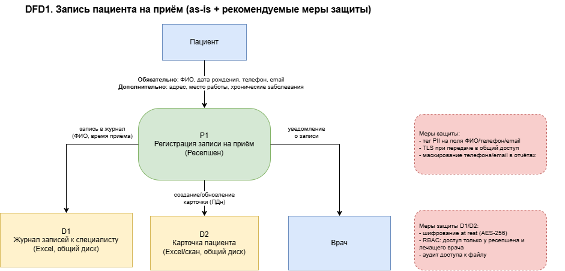
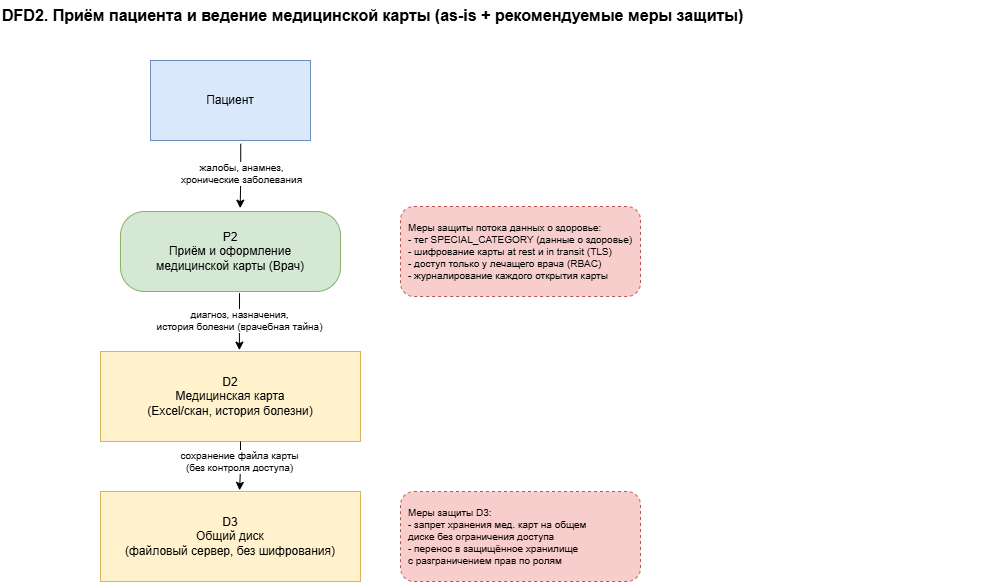
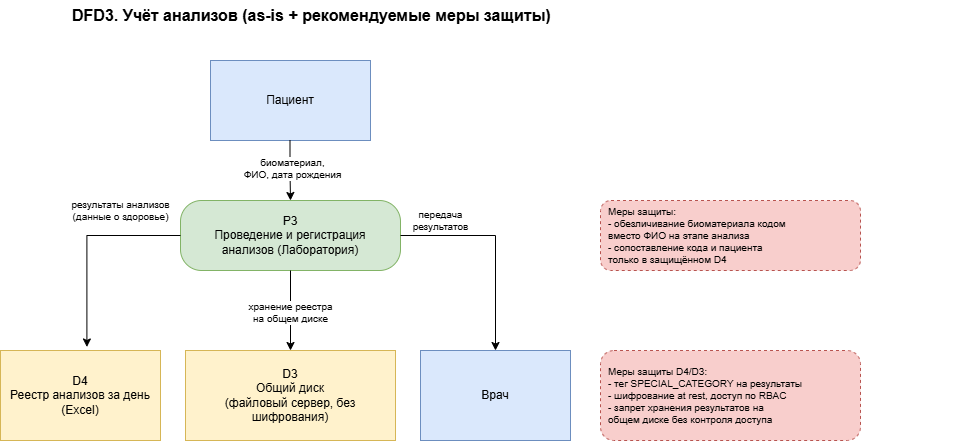
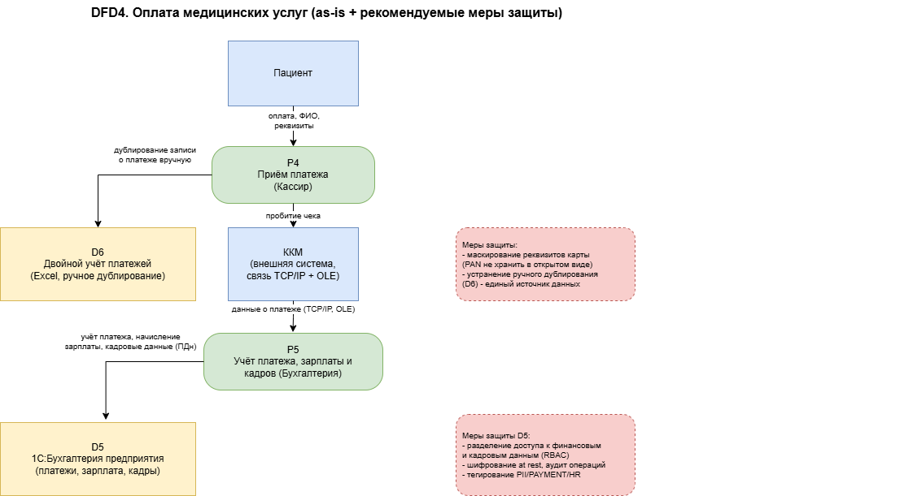

# Анализ безопасности системы

## Диаграммы потоков данных

Самые важные процессы изображенные ниже, которые обрабатывают конфиденциальные данные: запись пациента, ведение медицинской карты, учёт анализов и оплата услуг. Поток данных показывает внешние субъекты, процессы, хранилища данных, а также блоки с рекомендуемыми мерами защиты на этапе ввода данных, их обработки и хранения.

## Аудит мер по обеспечению безопасности данных 

Выевлены следующие проблемные зоны, в ходе построении диаграмм потоков данных

- Конфиденциальные данные, не учтённые во внутренних системах  
  - Расширенная анкета пациента заполняется вручную и отсутствует отдельная категория данных для учета данной информации. Хранится в Excel-файлах, что не удобно для автоматизации и быстрого реагирования  
  - Информация о полученных анализов и поставленные диагнозы являются особой категории (сведения о здоровье, врачебная тайна) и при этом хранятся в папках общего доступа к диску  
  - Кадровые данные сотрудников (зарплата, налоги) обрабатываются в той же системе "1С:Бухгалтерия предприятия", что и платежи пациентов, без разделения доменов  
  - Реквизиты оплаты, включая используемые данные карты, не выделены как отдельная защищаемая категория и фиксируются в форме учёта платежа вместе с ФИО  

- Нет контроля доступа к файлам. Любой сотрудник с доступом к диску может открыть медицинскую карту, реестр анализов или платёжные данные другого отдела  
- Нет шифрования данных. Данные не шифруются и файлы копируются и пересылаются в открытом виде  
- Нет аудита действий с данными. Открытие, изменение и копирование файлов не логируются, поэтому в случае инцидента утечки или установить, кто и когда обращался к данным пациента становится невозможным  
- Ручное дублирование данных. Кассиры ведут двойной учёт платежей в Excel и в 1С, что приводит к увеличентю риску утечки персональных данных  
- Смешение категорий данных в одном хранилище. Обычные контактные данные, данные о здоровье (особая категория) и платёжные данные хранятся без разделения по доменам и уровням чувствительности  
- Отсутствие тегирования и классификации данных не позволяет автоматически применять политики защиты и проверять релизы  
- Отсутствие процесса удаления данных по запросу субъекта, как того требует законодательство РФ  
- Отсутствие сегментации сети. ККМ подключены к серверу напрямую по TCP/IP через OLE без выделенного защищённого сегмента сети, что увеличивает риск компрометации канала передачи платёжных данных  
- Нет мониторинга и алертинга по нетипичным действиям  

- Сопоставление с требованиями и практиками  
 - Требования 152-ФЗ "О персональных данных" (РФ): обязательное разделение данных по категориям, ограничение доступа, учёт согласий и возможность прекращения обработки - не выполняются  
 - Privacy by Design: обработка данных не спроектирована с защитой по умолчанию  
 - Data Minimization: собираются избыточные данные (расширенная анкета)  
 - Data Lineage: невозможно проследить путь конкретного значения от точки сбора до точки хранения данных  

- Ключевые проблемы
 - отсутствие ролевого разграничения доступа (только доменная аутентификация)
 - отсутствие шифрования и аудита действий с данными
 - смешение данных разных категорий чувствительности в общих хранилищах
 - ручное дублирование платёжных данных
 - отсутствие процесса удаления данных по запросу пациента.

## План защиты данных

- Список данных для защиты и способы защиты  
 - ФИО, дата рождения, телефон, email пациента - обфускация в отчётах и логах, шифрование at rest  
 - Адрес прописки, место работы или учёбы (расширенная анкета) - минимизация сбора (запрашивать только при явной необходимости), шифрование at rest, ограничение срока хранения  
 - Диагноз, назначения, история болезни (данные о здоровье) - шифрование at rest и in transit, обезличивание при выгрузке для аналитики, доступ строго по ролям (лечащий врач и пациент)  
 - Результаты анализов - обезличивание на этапе проведения анализа (замена ФИО на код), сопоставление кода с пациентом только в защищённом хранилище, шифрование at rest  
 - Реквизиты оплаты (данные карты) - маскирование (хранение только последних цифр), запрет хранения полного номера карты, шифрование канала передачи в ККМ  
 - Данные о платежах пациента - шифрование at rest, устранение ручного дублирования между Excel и 1С  
 - Кадровые данные сотрудников (зарплата, налоги) - шифрование at rest, разделение домена от платежей пациентов, ограничение доступа по ролям  
 - Данные ТМЦ и закупок - обфускация не требуется (не относится к ПДн), но нужен контроль целостности и доступа по ролям склада  

- Механизм тегирования данных  
 - PII - персональные данные (ФИО, дата рождения, телефон, email, адрес)  
 - SPECIAL_CATEGORY - данные о здоровье (диагноз, история болезни, результаты анализов)  
 - PAYMENT - платёжные и банковские данные  
 - HR - кадровые данные сотрудников  
 - INTERNAL - данные, не относящиеся к перечисленным категориям (например, учёт ТМЦ)  
 - Data catalog с поддержкой классификации (например, Apache Atlas или аналог) - для автоматического сканирования и присвоения тегов на основе паттернов (regex для email, телефона, номера карты)  
 - DLP-система (Data Loss Prevention) - для контроля исходящих каналов (почта, диск, печать) на предмет тегированных данных  
 - CI-проверка релиза - автоматическая проверка, что новый код или интеграция не открывает доступ к полям с тегами SPECIAL_CATEGORY и PAYMENT без прохождения политики доступа  

- Инструменты, способы и меры для защиты потоков данных  
 - Шифрование at rest (AES-256) для всех хранилищ, где лежат данные с тегами PII, SPECIAL_CATEGORY, PAYMENT, HR  
 - TLS для любой передачи данных между системами и отделами, включая интеграцию с лабораторией и ККМ  
 - RBAC/ABAC на уровне будущей единой системы хранения - доступ к данным определяется ролью сотрудника и категорией данных, а не только фактом сетевой аутентификации  
 - Обезличивание (псевдонимизация) для передачи данных в аналитические сервисы (BI, ML) - замена прямых идентификаторов на псевдонимы с отдельной таблицей сопоставления под ограниченным доступом  
 - Маскирование данных в интерфейсах и отчётах, где не требуется полное значение (например, отображение телефона в формате +7 *** *** ** 12)  
 - Журналирование и аудит всех операций чтения/записи с тегированными данными, передача журналов в систему мониторинга и алертинга  
 - Единый источник данных (single source of truth) для платежей - устраняет ручное дублирование между Excel и 1С  
 - Регламент удаления и ограничения обработки данных по запросу пациента, встроенный в процессы ресепшена и IT-отдела  
