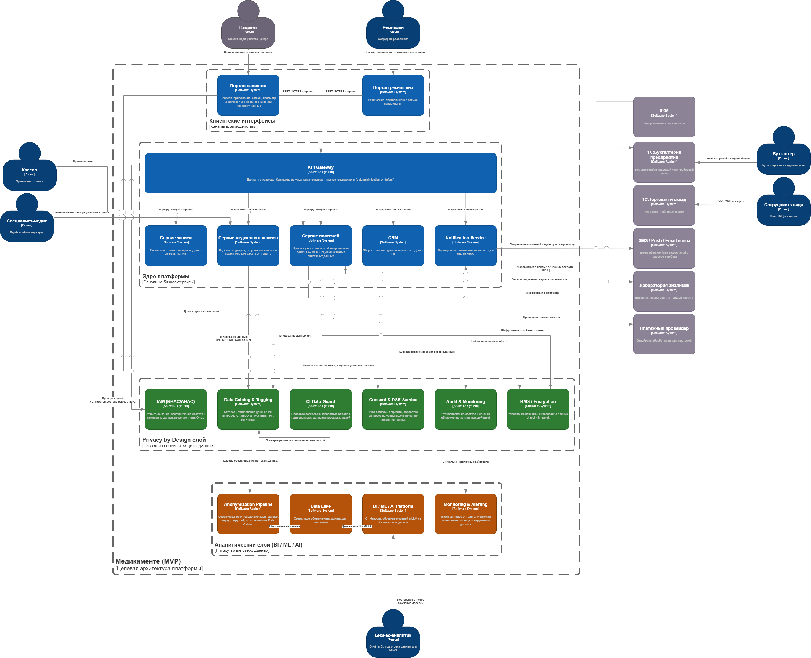

# Проектирование решения

## Добавленные блоки для соблюдения Privacy by Design

- **API Gateway** - единая точка входа для пациента и сотрудников ресепшена. Контракты API по умолчанию скрывают чувствительные поля (data minimization by default)  
- **IAM (RBAC/ABAC)** - проверяет роли и атрибуты доступа к каждой категории данных на каждый запрос через API Gateway  
- **Data Catalog & Tagging** - каталог и тегирование данных по категориям PII, SPECIAL_CATEGORY, PAYMENT, HR, INTERNAL. Сервисы медкарт и CRM помечают данные тегами при создании, теги используются IAM, KMS и аналитическим слоем  
- **Consent & DSR Service** - учёт согласий пациента на обработку данных, полученных через портал пациента, и обработка запросов на удаление или ограничение обработки данных  
- **Audit & Monitoring** - журналирует все запросы к данным через API Gateway, обнаруживает нетипичные действия и передаёт сигналы в Monitoring & Alerting  
- **KMS / Encryption** - управление ключами и шифрование данных доменов PII/SPECIAL_CATEGORY (медкарты) и PAYMENT (платежи) at rest и in transit  
- **CI Data-Guard** - автоматическая проверка релизов на корректную работу с тегированными данными перед выкладкой, по правилам из Data Catalog  

Основные бизнес-сервисы (запись, медкарты и анализы, платежь, CRM, уведомления) работают через API Gateway, с целью проверки доступа и журналирования

## Аналитический слой с учётом Privacy by Design

Добавлен слой "Аналитический слой (BI/ML/AI)", который получает данные не напрямую из бизнес-сервисов, а через цепочку защиты:

1. **Data Catalog & Tagging** передаёт в **Anonymization Pipeline** правила обезличивания, привязанные к тегам данных.
2. **Anonymization Pipeline** обезличивает и псевдонимизирует данные из доменов PII, SPECIAL_CATEGORY и PAYMENT перед загрузкой.
3. Обезличенные данные попадают в **Data Lake** - единственный источник данных для аналитики.
4. **BI / ML / AI Platform** строит отчётность и обучает модели (включая LLM) только на обезличенных данных из Data Lake.
5. **Monitoring & Alerting** получает от Audit & Monitoring сигналы о нетипичных действиях с данными и оповещает команду.

Такая схема закрывает бизнес-цель компании по развитию BI/ML/AI-сервисов на основе данных, ранее хранившихся в Excel, не нарушая требований конфиденциальности: аналитики и модели никогда не работают с исходными идентифицируемыми данными пациентов

## Легаси-интеграции

Бухгалтерия и склад продолжают работать через "1С:Бухгалтерия предприятия" и "1С:Торговля и склад" напрямую, как в текущей архитектуре. Сервис платежей становится единым источником платёжных данных и передаёт информацию о платежах в 1С, вместо ручного дублирования в Excel и 1С. Интеграция с лабораторией анализов и приём онлайн-платежей через эквайринг реализованы как внешние API-интеграции сервиса медкарт и сервиса платежей соответственно

