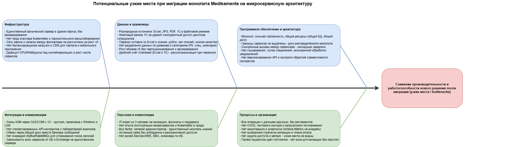

# Оценка узких мест при миграции

## Анализ ситуации

Медикаменте переходит от монолитного бэк-офиса (Excel, 1С в файловом режиме, единственный физический сервер с Windows Server 2022) к микросервисной архитектуре с порталами, платёжным шлюзом, CRM и интеграцией с лабораторией. Одновременно бизнес открывает филиалы и ожидает пятикратный рост объёма данных и числа пользователей.  

Миграция затрагивает следующик процессы и компоненты:  

- **Хранение данных:** переход из Excel, JPG, PDF и файловых баз 1С в единую СУБД  
- **Коммуникационные каналы:** сеть офиса и филиалов, интеграция ККМ через OLE, будущий обмен между сервисами  
- **Серверное оборудование:** единственный сервер в здании офиса, отсутствие прод-кластера Kubernetes  
- **Бизнес-логика:** монолит с сильной связанностью и общими ресурсами, границы сервисов не выделены  
- **Персонал и процессы:** IT-отдел из 3 человек, ручные операции, отсутствие CI/CD и мониторинга  

## Диаграмма Исикавы отображает

- **"Голова рыбы"** - целевой негативный эффект: снижение производительности и работоспособности нового решения после миграции  
- **"Кости"** - категорий причин  

### Инфраструктура

- Нет прод-кластера Kubernetes и горизонтального масштабирования (k8s только в стеке техдиректора)  
- Нет балансировщиков нагрузки и CDN для портала пациента и мобильного приложения  
- Пропускная способность сети офиса и каналов между филиалами не рассчитана на рост x5  
- Единственный физический сервер в здании офиса, без резервирования и отказоустойчивости  
- Дефицит CPU, RAM и дискового пространства под контейнеризацию и рост числа сервисов  

### Данные и хранилища

- Нет разделения данных по доменам и категориям (PII, специальные категории, платежи)  
- Перенос исторических данных из Excel и сканов: дубли, отсутствие ключей, низкое качество  
- Разнородные источники: Excel, JPG, PDF, 1С в файловом режиме, нет единой СУБД  
- Файловый режим 1С не выдерживает конкурентный доступ десятков сотрудников новых филиалов  
- Двойной учёт платежей в Excel и 1С - риск рассинхронизации при переносе  
- Рост объёма данных x5 без партиционирования, индексов под нагрузку и архивирования  

### Программное обеспечение и архитектура

- Синхронные вызовы между будущими сервисами дают каскадные задержки и отказы  
- Нет кэширования, пулов соединений, асинхронной обработки уведомлений и напоминаний  
- Границы сервисов не выделены - высокий риск получить распределённый монолит  
- Монолит с сильной связанностью и общими ресурсами (общая БД, общий диск)  
- Нет версионирования API и контроля обратной совместимости контрактов  

### Интеграции и коммуникации

- Обмен данными идёт через общий файловый диск вместо брокера сообщений  
- API-контракты с лабораторией анализов не спроектированы  
- Все сервисы зависят от Active Directory и Exchange на единственном сервере (единая точка отказа)  
- Связь ККМ с 1С через OLE/COM хрупкая и жёстко привязана к Windows и локальной сети  
- Нет очередей (Kafka, RabbitMQ) для сглаживания пиков нагрузки при массовой записи  

### Персонал и компетенции

- Bus factor: сетевой администратор - единственный носитель инфраструктурных знаний  
- Активный найм без онбординга и разграничения доступа увеличивает нагрузку и риски  
- IT-отдел из 3 человек одновременно ведёт миграцию, запуск филиалов и поддержку  
- Нет выделенных ролей DevOps/SRE, DBA и инженера по информационной безопасности  
- Нет опыта промышленной эксплуатации микросервисов и Kubernetes  

### Процессы и организация

- Приём пациентов идёт постоянно, нет технологического окна для миграции без простоя  
- Все операции с данными выполняются вручную, регламенты отсутствуют  
- Не выбрана стратегия миграции, нет плана отката  
- Нет CI/CD, тестового контура и нагрузочного тестирования под целевой рост x5  
- Нет мониторинга и алертинга (Victoria Metrics есть в стеке, но не внедрена)  
- Нет аудита доступа и метрик производительности - узкие места не видны заранее  

## Рекомендации и приоритеты

Приоритет очерёдности: высокий - блокирует безопасный старт миграции, средний - нужен до вывода MVP под нагрузку, низкий - масштабирование и оптимизация после MVP

### Высокий приоритет

1. Выбрать стратегию постепенной миграции (Strangler Fig), отказаться от big bang. Выделить бизнес-домены и явные границы сервисов до начала переноса  
2. Развернуть управляемую СУБД PostgreSQL как единый OLTP-источник, вынести данные из Excel и файловых баз 1С. Спроектировать разделение данных по доменам и категориям  
3. Поднять отказоустойчивую инфраструктуру: резервный узел или кластер Kubernetes, регулярные бэкапы и репликацию. Оценить переезд в облако или colocation вместо сервера в офисе  
4. Внедрить брокер сообщений (Kafka) для асинхронной записи на приём, напоминаний и обмена между сервисами, чтобы сгладить пики нагрузки  
5. Выделить и нанять роли DevOps/SRE, DBA и инженера по ИБ. Задокументировать инфраструктуру, снизить bus factor  

### Средний приоритет

6. Построить CI/CD с отдельным тестовым контуром и регулярным нагрузочным тестированием на профиле роста x5  
7. Внедрить мониторинг, алертинг и трассировку (Victoria Metrics, Grafana, distributed tracing) до начала миграции и зафиксировать базовые метрики latency и throughput  
8. Спроектировать версионируемые API-контракты с лабораторией и внешними партнёрами, по умолчанию скрывающие конфиденциальные поля  
9. Провести профилирование, дедупликацию и очистку исторических данных, задать первичные ключи до переноса  
10. Пересмотреть интеграцию ККМ: перейти от OLE к сетевому API или отдельному сервису фискализации  

### Низкий приоритет

11. Модернизировать сеть филиалов: каналы связи, VPN, балансировщики нагрузки, CDN для портала и мобильного приложения  
12. Ввести регламенты доступа (RBAC/ABAC), согласовать технологическое окно миграции с минимальным простоем и отработать план отката  
