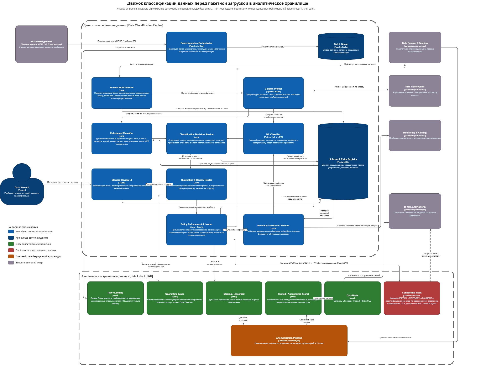

# Классификация данных

## Описание контейнеров и потока обработки

Пакетный конвейер, каждый контейнер отвечает за один шаг.

- **Schema Drift Detector** - сверяет структуру батча с реестром схем, версионирует схему, помечает новые и изменённые поля как не классифицированные. Классификации подлежат только такие поля; стабильные колонки берут класс из кэша прошлых решений  
- **Schema & Rules Registry (PostgreSQL)** - версии схем, правила, справочники, пороги уверенности, полная история решений по каждой колонке  
- **Column Profiler (Apache Spark)** - профилирует колонки, требующие классификации: типы, кардинальность, доля пустых значений, паттерны, статистика, репрезентативная выборка значений. Работает на выборке строк, а не на всём объёме  
- **Batch Ingestion Orchestrator (Apache Airflow)** - по расписанию забирает данные из источников (бизнес-сервисы, CRM, 1С, выгрузки Excel и сканов), кладёт сырой батч в слой Raw / Landing без изменений и ставит задачу классификации в очередь  
- **Rule-based Classifier** - детерминированные правила и регулярные выражения (ИНН, СНИЛС, номер телефона, e-mail, номер карты, дата рождения, коды МКБ), справочники и имена полей. Быстрый и объяснимый путь, закрывает большинство колонок  
- **ML Classifier (Python, ML + NER)** - классифицирует колонки, для которых правила не дали однозначного ответа, по признакам профиля и содержимому (в том числе распознавание сущностей в значениях)  
- **Batch Queue (Apache Kafka)** - буфер батчей и отдельных колонок, ожидающих классификации. Разрывает связь между приёмом данных и их обработкой, сглаживает пики и позволяет масштабировать обработку независимо от приёма  
- **Classification Decision Service** - агрегирует голоса rule-based и ML, применяет политику приоритета и fail-safe, вычисляет итоговый класс колонки и уровень уверенности (confidence), пишет решение и историю в реестр  
- **Policy Enforcement & Loader (Java + Spark)** - по классу колонки применяет трансформации (маскирование, токенизация, псевдонимизация, обобщение), получает ключи из KMS, публикует теги классов в Data Catalog и раскладывает данные по слоям хранилища  
- **Quarantine & Review Router** - если уверенность ниже порога или классификаторы дали противоречивый результат, батч уходит в слой Quarantine и в очередь ручной проверки; иначе батч передаётся на загрузку  
- **Steward Review UI (React)** - интерфейс Data Steward: разбор карантина, подтверждение и исправление классов, ведение правил и справочников. Подтверждённые классы становятся эталонной разметкой  
- **Metrics & Feedback Collector** - собирает метрики качества классификации и фидбек стюардов, формирует обучающую выборку для дообучения ML Classifier  

Ключевой приём против дрейфа схемы и отсутствия разметки: классификация выполняется на уровне отдельных колонок по их содержимому и профилю, а не по заранее известной структуре. Новая или изменившаяся колонка автоматически попадает на классификацию, неопределённость трактуется в пользу защиты.

## Организация хранилища с испольщованием следующих слоев + дополнительные меры

Данные проходят через слои с нарастающей доступностью и убывающей чувствительностью.

- **Raw / Landing** - сырые батчи как есть. Шифрование по умолчанию, максимальный класс, короткий срок хранения, доступ только у движка. Нужен для повторной обработки и профилирования, наружу не отдаётся  
- **Staging / Classified** - данные с проставленными тегами классов, ещё не обезличенные. Промежуточный слой перед обезличиванием  
- **Trusted / Anonymized (Core)** - обезличенные и псевдонимизированные данные. Основной слой для широкого аналитического доступа, BI и обучения моделей  
- **Quarantine Layer** - батчи и колонки с низкой уверенностью классификации или конфликтом классов. Доступ только у Data Steward, пока класс не подтверждён  
- **Confidential Vault (sensitive enclave)** - отдельный слой для колонок SPECIAL_CATEGORY и PAYMENT, которые нужны аналитике в идентифицируемом виде по обоснованию. Отдельное шифрование, column-level security, доступ строго по ABAC, полный аудит каждого обращения  
- **Data Marts** - витрины BI поверх Trusted с row-level и column-level security  

Обезличивание между Staging и Trusted выполняет Anonymization Pipeline из целевой архитектуры по правилам, привязанным к тегам классов в Data Catalog. Меры помимо слоёв:  

- Шифрование по классу через KMS (envelope encryption), отдельные ключи для SPECIAL_CATEGORY и PAYMENT  
- Классификация как обязательный шлюз: батч не попадает в Trusted и в витрины, пока все его колонки не получили класс (автоматически или через стюарда)  
- Аудит доступа к Confidential Vault и передача аномалий в Monitoring & Alerting  
- Динамическое маскирование при чтении и column-level security для чувствительных колонок, попавших в общие слои  
- Политики хранения и удаления по классу; запросы на прекращение обработки данных пациента исполняются во всех слоях (связь с Consent & DSR Service)  
- Теги классов из Data Catalog используются CI Data-Guard при проверке релизов  

## Метрики эффективности классификации

- **F1 по каждому классу** - сбалансированная оценка, считается по эталонной разметке стюардов и золотому набору  
- **Automation rate** - доля колонок, классифицированных без участия человека  
- **Recall по чувствительным классам (PII, SPECIAL_CATEGORY, PAYMENT)** - доля таких колонок, которые движок распознал правильно. Целевое значение близко к 1, ложноотрицательные срабатывания по этим классам - критический инцидент  
- **Precision по классам** - доля колонок, отнесённых к классу верно. Низкая precision означает избыточную защиту и лишние ограничения для аналитики  
- **Quarantine rate** - доля батчей и колонок, ушедших в карантин  
- **Tag coverage перед загрузкой** - доля колонок с проставленным классом на входе в Trusted. Должна быть 100 процентов  
- **Стоимость классификации на батч** - расход ресурсов rule-based и ML путей  
- **Schema drift rate** - доля новых и изменённых полей в батче, скорость дрейфа  
- **Время классификации батча и пропускная способность** - latency и throughput конвейера  

Как метрики помогают оптимизации:  

- Падение recall по SPECIAL_CATEGORY - повод ужесточить правила, добавить справочники, понизить порог уверенности или дообучить модель на свежих примерах  
- Рост schema drift rate - работа с владельцами источников над стабильностью контрактов, приоритизация автоклассификации  
- Рост quarantine rate - сигнал, что правил и обучающих данных не хватает для новых структур; добавляются правила, расширяется обучающая выборка  
- Низкая precision - правила и модель дают ложные срабатывания, пороги и признаки пересматриваются, снимаются лишние ограничения с аналитики  
- Ухудшение latency и throughput - масштабирование Spark и числа обработчиков, вынос большего объёма полей на быстрый rule-based путь  

Метрики Metrics & Feedback Collector передаёт в Monitoring & Alerting, отклонения за пороги поднимают алерт.

## Масштабируемость и план расширения

- **Два пути обработки** - дешёвый rule-based закрывает большинство колонок, дорогой ML-путь работает только с остатком; при росте объёма доля rule-based наращивается за счёт новых правил и справочников  
- **Stateless-контейнеры классификаторов** - Schema Drift Detector, Rule-based Classifier, ML Classifier, Decision Service работают без общего состояния и масштабируются горизонтально в Kubernetes, автоскейл по глубине очереди  
- **Профилирование и ML-инференс на Spark** - партиционирование по источнику, таблице и батчу, параллельная обработка колонок, работа на выборках, а не на полном объёме  
- **Масштабирование хранилища** - слои и витрины разносятся по отдельным ресурсам, чувствительный доступ изолирован в Confidential Vault, для роста числа пользователей применяются RLS, CLS и кэш витрин  
- **Расширение реестра** - Schema & Rules Registry шардируется по источнику или домену, история решений архивируется  
- **Рост числа источников и филиалов** - подключение нового источника это новый DAG в оркестраторе и новая ветка схем в реестре, ядро движка не меняется  
- **Разделение приёма и обработки через Kafka** - батчи буферизуются, число обработчиков классификации масштабируется независимо от нагрузки на приём  
- **Инкрементальная классификация** - переклассифицируются только новые и изменённые поля; для стабильных схем класс берётся из кэша решений в реестре, что ограничивает рост нагрузки при увеличении объёма данных  
